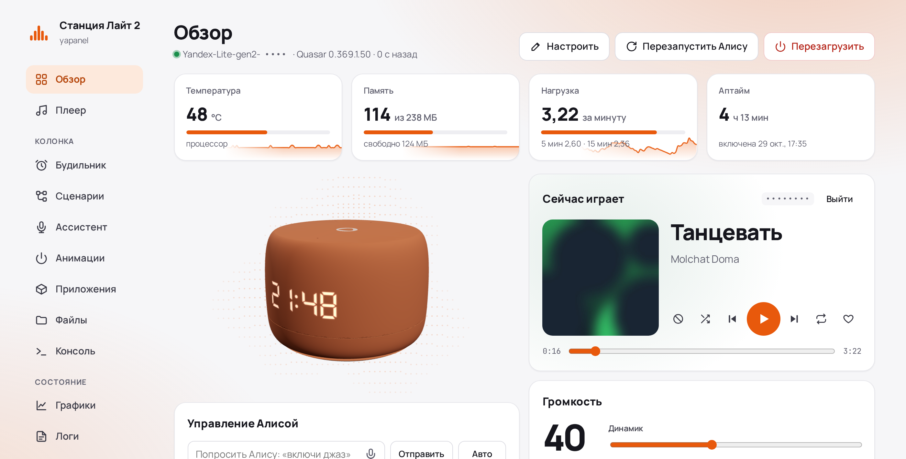
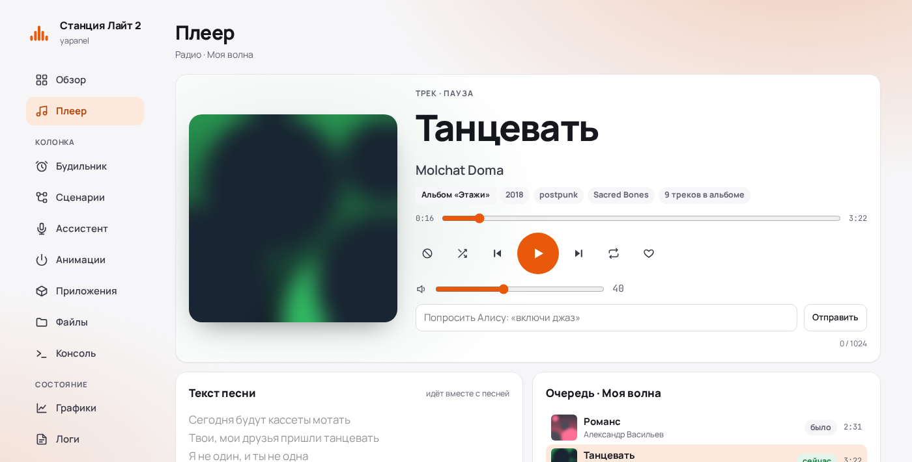
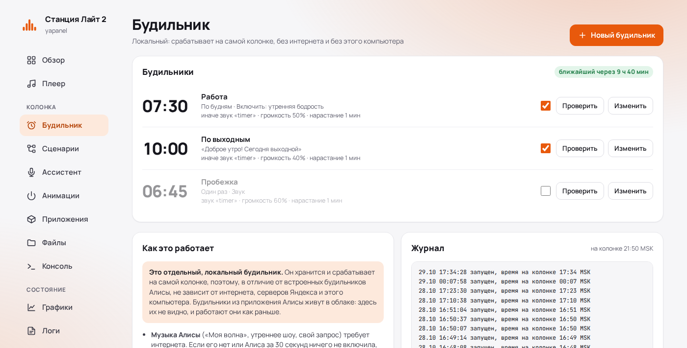
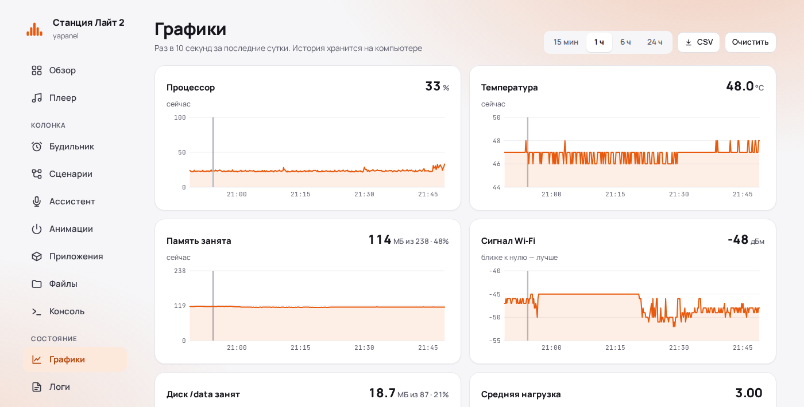
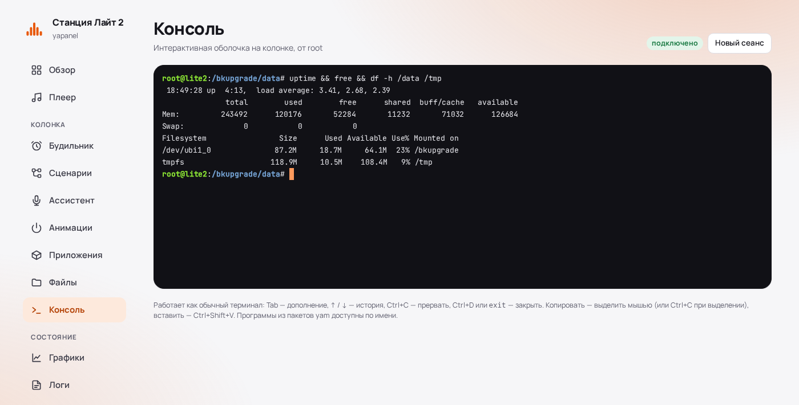
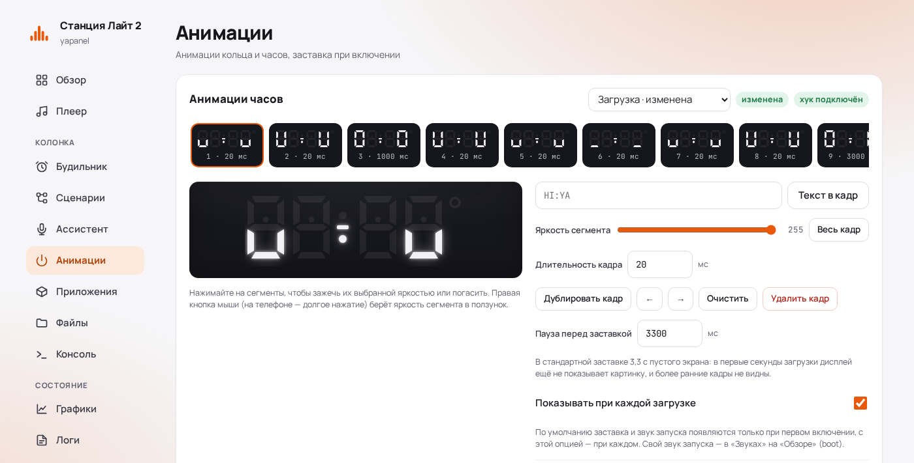
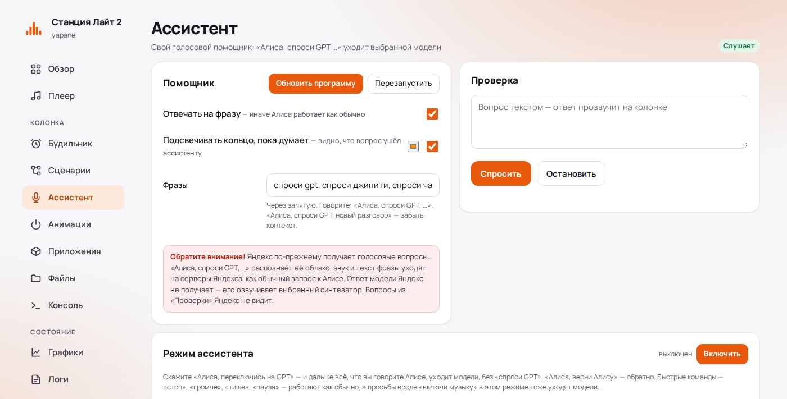
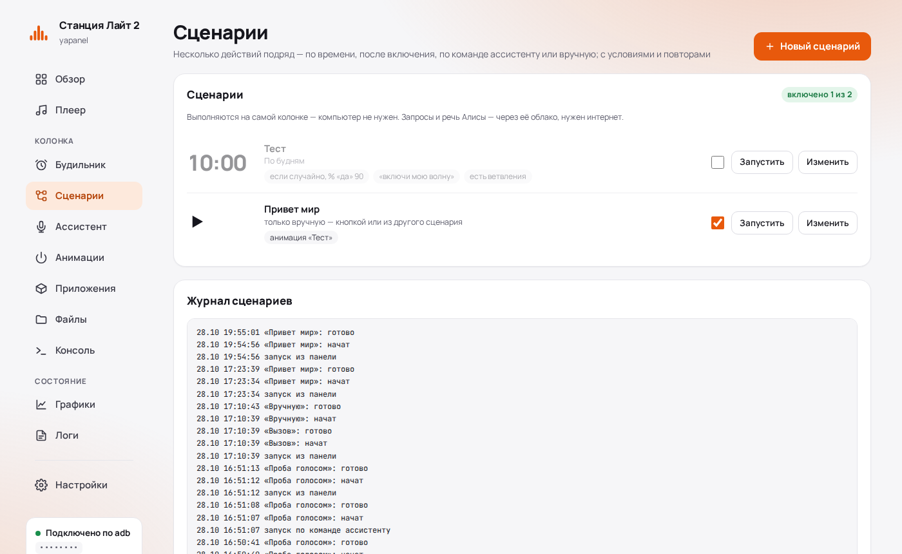
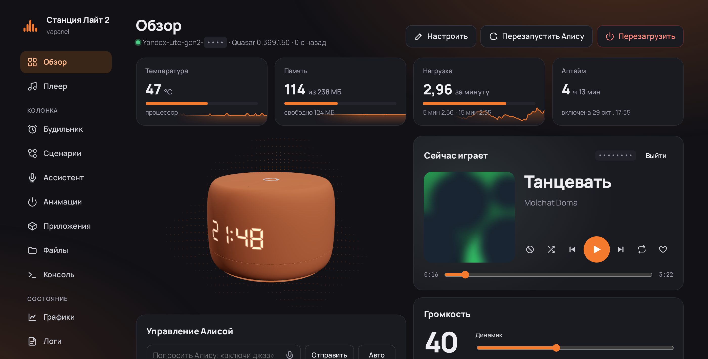

# Веб-панель для Яндекс Станций

Локальная веб-панель для **Яндекс Станций с root-доступом по adb** — Лайт 2, а также Лайт, Мини 3 Про, Станции 2
и Мини 3 (см. [Другие модели](#другие-модели-и-несколько-колонок)): музыка и плеер, будильник, который
работает без интернета, своя заставка и звук запуска, подсветка и дисплей часов, Bluetooth, графики, файлы,
логи и интерактивная root-консоль. Всё работает в локальной сети, через adb и локальный протокол колонки.
Отдельно ставить на колонку ничего не нужно.

> [!WARNING]
> Неофициальный проект, не связан с Яндексом. Панель работает только на колонке, где уже есть root-доступ по adb,
> и сама колонку не рутирует. Консоль, файлы и некоторые функции дают полный доступ к системе колонки:
> используйте на свой риск.



<table>
  <tr>
    <td width="50%"></td>
    <td width="50%"></td>
  </tr>
  <tr>
    <td align="center">Плеер: текст песни, очередь, похожие треки</td>
    <td align="center">Локальный будильник</td>
  </tr>
  <tr>
    <td width="50%"></td>
    <td width="50%"></td>
  </tr>
  <tr>
    <td align="center">Графики за сутки</td>
    <td align="center">Интерактивная root-консоль</td>
  </tr>
  <tr>
    <td width="50%"></td>
    <td width="50%"></td>
  </tr>
  <tr>
    <td align="center">Редактор анимаций: часы по кадрам с яркостью сегментов, кольцо</td>
    <td align="center">Свой голосовой ассистент на любой OpenAI-совместимой модели</td>
  </tr>
  <tr>
    <td width="50%"></td>
    <td width="50%"></td>
  </tr>
  <tr>
    <td align="center">Сценарии на поле нод: условия, речь Алисы, вопрос ассистенту</td>
    <td align="center">Тёмная тема</td>
  </tr>
</table>

## Содержание

- [Возможности](#возможности)
- [Что нужно](#что-нужно)
- [Установка](#установка): [Windows](#windows--запускать-когда-нужно) · [macOS](#macos--запускать-когда-нужно) · [Linux](#linux--запускать-когда-нужно) · [Docker](#docker--постоянно-на-сервере)
- [Другие модели и несколько колонок](#другие-модели-и-несколько-колонок)
- [Параметры](#параметры)
- [Безопасность](#безопасность)
- [Что панель ставит на колонку](#что-панель-ставит-на-колонку)
- [Как это устроено](#как-это-устроено)
- [Благодарности и лицензии](#благодарности-и-лицензии)

## Возможности

**Каждый день**
- **Обзор** — температура, память, Wi‑Fi, аптайм; 3D-модель колонки в цвете корпуса, на которой в реальном времени
  повторяются дисплей часов и кольцо; громкость, «Сказать на колонке» (голосом Алисы или ассистента), звуки колонки (любой можно заменить своим и вернуть)
  и свои файлы, подсветка, дисплей часов (текст, дата,
  температура, таймер). Виджеты можно переставлять и прятать.
- **Мини-плеер YouTube** — отдельная карточка в «Обзоре»: вставленная ссылка (или ID) играет в браузере,
  с перемоткой, громкостью, полноэкранным режимом и историей последних роликов. Звук идёт с устройства,
  где открыта панель, аккаунт не нужен. Если ролик нельзя встроить или YouTube не открывается, карточка
  так и пишет и предлагает открыть его на YouTube.
- **Плеер** — что играет, управление, громкость, команды Алисе, текст песни с подсветкой текущей строки
  (Яндекс Музыка или [LRCLIB](https://lrclib.net)), очередь, похожие треки, об исполнителе, ссылки на Яндекс Музыку.
  Вход в Яндекс — по QR-коду. Музыку с телефона по Bluetooth плеер тоже показывает.
- **Управление Алисой** — текст и микрофон с удержанием, «Авто» с настраиваемой паузой и ожиданием конца ответа колонки.
  Нужны HTTPS и Chrome/Edge/Safari; распознаёт браузер (в Chrome — через Google), аудио панель не сохраняет.
  Сертификат HTTPS создаётся автоматически и доступен для скачивания в настройках.
- **Будильник** — работает на самой колонке, даже когда компьютер с панелью выключен. «Моя волна», утреннее шоу,
  любой запрос Алисе или свой звук; если нет интернета — играет звук. Нарастание громкости, «отложить»,
  выключение кнопкой на колонке или голосом.
- **Сценарии** — отдельная вкладка: действия по времени, после включения колонки, по команде ассистенту
  («Алиса, спроси GPT, спать») или только вручную (кнопкой или из другого сценария), тоже прямо на колонке. Запрос Алисе, её речь, вопрос своему ассистенту, вкл/выкл режима
  ассистента, громкость (сразу или плавно), звук, цвет кольца, паузы и ожидания
  («до 7:00», «пока не замолчит»), «стоп», запуск другого сценария; условия «если / иначе» (время, день недели,
  играет ли музыка, есть ли интернет, громкость, случайно) и повторы (до 20 кругов), предустановленные анимации кольца и
  часов. Простые сценарии правятся списком, с
  ветвлениями — нодами на поле. Свой журнал.
- **Ассистент** — свой голосовой помощник: «Алиса, спроси GPT, …» уходит выбранной модели вместо
  Алисы. Любой OpenAI-совместимый API (OpenAI, OpenRouter, Groq, Gemini, Command Code, Ollama и LM Studio на своём
  компьютере), свой системный промт, память разговора, прокси. Отвечает голосом Алисы или OpenAI-совместимым
  синтезатором (например, Piper через openedai-speech). Работает на самой колонке, компьютер не нужен; ключи хранятся
  только на колонке, отдельно для каждого провайдера. Голосовой вопрос по-прежнему распознаёт облако Яндекса, так что он уходит Яндексу;
  ответ модели — тоже, если его читает Алиса.

**Колонка**
- **Анимации** — редактор любых анимаций кольца (по кадрам или текстом) и часов (покадровый), своя заставка.
  Встроенную можно изменить (стандартная не стирается: своя версия накрывает её, «вернуть» снимает подмену) или
  добавить свою отдельную («＋ Добавить новую…» в списке) — её можно играть с «Обзора» и из сценариев, ничего не трогая во встроенных.
- **Приложения** — [yam 2](https://github.com/nyakokitsu/yam), пакетный менеджер на колонке: панель ставит его в
  `/data/yam` (с проверкой SHA-256 релиза), подключает официальный каталог, ставит и удаляет пакеты под модель колонки,
  проверяет и чинит их (`doctor`/`repair`). Службы пакетов (например, Luna) yam сам не запускает — это делает панель:
  «Запустить» и «При загрузке» через хук. Старый yam (yamd, v0.1) с реестром
  [yapkg](https://github.com/nyakokitsu/yapkg) остаётся в свёрнутом блоке ниже.
- **Файлы** — просмотр, правка, загрузка и скачивание, проигрывание аудио прямо с колонки.
- **Консоль** — настоящий терминал (xterm.js): Tab, история, Ctrl+C, `top`, `vi`.
- **Bluetooth** — сопряжённые устройства, подключение и «забыть», видимость на 3 минуты.

**Состояние**
- **Графики** — процессор, температура, память, диск, Wi‑Fi, нагрузка и воспроизведение за сутки, события
  (перезагрузки, обрывы связи, будильники), выгрузка в CSV.
- **Логи** — логи демонов Quasar и dmesg с фильтром, а ещё журнал самой панели: что нажимали, чем ответила колонка,
  обрывы связи. Хранится рядом с панелью (`.panel_journal.jsonl`, последние 1000 записей), тексты запросов в него не попадают.

**Панель**
- Пароль, HTTPS со своим сертификатом, установка как приложение (PWA), светлая и тёмная тема, цвет акцента.
- Резервная копия всего, что панель поставила на колонку, и полное удаление в один клик.

## Что нужно

- Яндекс Станция Лайт 2 с **root-доступом по adb** — по сети (`adb connect <IP>:5555`) или по USB.
- Компьютер или сервер в той же сети:
  - **Python 3.9+** (только стандартная библиотека) и **adb** ([Android platform-tools](https://developer.android.com/tools/releases/platform-tools) 28 или новее — старый adb, например 1.0.31 из старых дистрибутивов, панель не примет);
  - для заставки и анимаций часов (формат zstd) — **Python 3.14+** или программа **zstd**;
  - по желанию **ffmpeg** — чтобы играть mp3/ogg/opus и менять звуки (без него — только WAV) и **openssl** — для HTTPS;
  - или **Docker** — там всё уже есть.

## Установка

### Windows — запускать, когда нужно

1. Скачайте со страницы [Releases](https://github.com/dimap/yandex-station-web/releases/latest) архив
   `…-windows-x64.zip` (для ARM-ноутбуков — `…-windows-arm64.zip`) и распакуйте в любую папку.
2. Дважды щёлкните **`start.bat`**.

Python в архиве уже есть. Остальное `start.bat` сделает сам. Если в системе нет adb или ffmpeg, он предложит скачать их
в папку `runtime` рядом с панелью: platform-tools с сайта Google
(~7 МБ) и по желанию ffmpeg (~110 МБ, нужен для mp3/ogg и своих звуков). В систему ничего не устанавливается,
права администратора не нужны; чтобы убрать всё, достаточно удалить папку. При первом запуске панель откроется
в браузере и сама найдёт колонку в сети (если колонок несколько — даст выбрать), а адрес запомнит.

Можно и без архива из Releases: **Code → Download ZIP** — тогда `start.bat` при необходимости скачает ещё и
портативный Python с python.org (~11 МБ). Нужна Windows 10 (1803) или новее. Уже установленные Python 3.14+, adb (в `PATH` или папка `platform-tools`
рядом с `server.py`) и ffmpeg `start.bat` найдёт и использует.

### macOS — запускать, когда нужно

1. Установите [Homebrew](https://brew.sh), если его ещё нет, затем зависимости в Терминале:

   ```sh
   brew install python ffmpeg zstd
   brew install --cask android-platform-tools
   ```

   Python и adb нужны для запуска; ffmpeg — для mp3/ogg и своих звуков, zstd — для анимаций
   при Python ниже 3.14. [Android platform-tools](https://formulae.brew.sh/cask/android-platform-tools)
   можно не ставить повторно, если adb уже установлен через Android Studio.

2. Скачайте **Code → Download ZIP** и распакуйте архив или склонируйте репозиторий:

   ```sh
   git clone https://github.com/dimap/yandex-station-web.git
   cd yandex-station-web
   ```

3. Дважды щёлкните **`start.command`** в Finder. Откроется Терминал, а панель — в браузере: при первом запуске
   она сама найдёт колонку в сети (или подключится по USB) и запомнит её адрес.
   Если macOS блокирует открытие скачанного скрипта, запустите его из Терминала в папке проекта:

   ```sh
   sh start.command
   ```

Можно сразу передать адрес и параметры:

```sh
./start.sh 192.168.1.50     # дальше достаточно ./start.sh или start.command
```

Скрипт находит Homebrew в `/opt/homebrew` на Apple Silicon и `/usr/local` на Intel.
adb также ищется в `~/Library/Android/sdk/platform-tools`, `ANDROID_HOME` и `ANDROID_SDK_ROOT`.
HTTPS использует доступный `openssl`; свой путь можно задать через `PANEL_OPENSSL`.
Панель: `http://127.0.0.1:8765/`. Остановить — Ctrl+C в окне Терминала.

### Linux — запускать, когда нужно

```sh
# Debian/Ubuntu: sudo apt install python3 adb ffmpeg zstd      Fedora: sudo dnf install python3 android-tools ffmpeg zstd
git clone https://github.com/dimap/yandex-station-web.git
cd yandex-station-web
./start.sh                  # первый раз панель сама найдёт колонку в сети и запомнит её адрес
./start.sh 192.168.1.50     # или сразу IP колонки
```

Панель откроется на `http://127.0.0.1:8765/`. Остановить — Ctrl+C.

### Docker — постоянно на сервере

Готовый образ: **`ghcr.io/dimap/yandex-station-web`** (amd64, arm64 и armv7 — подойдёт и Raspberry Pi).
Раньше он назывался `ghcr.io/dimap/yandex-lite2-web` — под старым именем образ пока тоже обновляется.
В нём уже есть adb, ffmpeg и openssl, клонировать репозиторий не нужно.

Одной командой (вместо `192.168.1.50` — IP колонки):

```sh
docker run -d --name yandex-station-web --network host --restart unless-stopped \
  -e ADB_SERIAL=192.168.1.50 -v "$PWD/data:/data" \
  ghcr.io/dimap/yandex-station-web:latest
```

Или через Docker Compose — сохраните как `docker-compose.yml` и запустите `docker compose up -d`:

```yaml
services:
  panel:
    image: ghcr.io/dimap/yandex-station-web:latest
    container_name: yandex-station-web
    network_mode: host               # сертификат HTTPS выпишется на адрес сервера в сети
    environment:
      ADB_SERIAL: "192.168.1.50"     # IP колонки (порт 5555 подставится сам)
      # PANEL_PORT: "8765"
      # PANEL_HTTPS_PORT: "8766"     # 0 — без HTTPS
    volumes:
      - ./data:/data
    restart: unless-stopped
```

Панель: `http://<адрес сервера>:8765/`. Всё своё (вход в Яндекс, пароль, сертификаты, история графиков,
ключ adb) хранится в `./data` и переживает обновления.

- **Обновить:** `docker compose pull && docker compose up -d` (или `docker pull` и пересоздать контейнер).
- **Версии:** `latest` — последняя из ветки `main`, `0.1.0` и т. д. — конкретный релиз.
- **Без `network_mode: host`** (Docker Desktop на Windows/macOS) — пробросьте порты `-p 8765:8765 -p 8766:8766`;
  панель работает так же, только HTTPS-сертификат будет выписан на адрес контейнера.
- **Собрать образ самому:** склонируйте репозиторий и запустите `docker compose up -d --build`
  с `build: .` вместо `image:` в `docker-compose.yml` из репозитория.

> В Docker панель открыта для всей локальной сети — **задайте пароль** во вкладке «Настройки» → «Доступ».

## Другие модели и несколько колонок

Изначально проект создавался под Лайт 2, но сейчас так же имеется базовая поддержка некоторых других колонок.
Панель сама определяет модель по плате колонки (платформа в `/proc/device-tree`) и запоминает её. При первом
подключении другой модели она один раз перезапускается с подходящим профилем. Задать профиль вручную —
`--model lite2 | lite | mini3pro | mini3 | mini2 | station2`.

| Профиль | Часы / подсветка | Запуск / будильник | Проверено на колонке |
|---|---|---|---|
| `lite2` | 36 сегментов / кольцо 3 RGB | есть | полностью |
| `mini3pro` | 36 сегментов / кольцо 16 RGB | отключены | чтение, часы, кольцо |
| `mini2` (Мини 2 с часами) | 4 цифры, двоеточие, минус, градус / логотип 6 RGB | отключены | чтение, часы, кольцо, анимации |
| `station2` | без часов / framebuffer 89 RGB | отключены | чтение |
| `mini3` | запись отключена | отключены | нет, экспериментальный |
| `lite` (Лайт 1-го поколения) | дисплея нет / кольцо 3 RGB | заставка отключена, будильник есть | кольцо, хук, будильник, звуки — автором [PR #6](https://github.com/dimap/yandex-station-web/pull/6) |

На других моделях скрипты загрузки Лайт 2 и будильник не подключаются. 3D-корпуса Станции 2, Мини 3,
Мини 3 Про, Мини 2 и Лайт первого поколения — реконструкции по фото производителя ([источники](static/models/SOURCES.md)).

**Станция Мини 2 с часами** (`yandex,station-mini2`, платформа Glagol `yandexmini_2`). Сегменты её дисплея
называются иначе, чем у Лайт 2 (цифры 1–4 без точек, двоеточие `PLUS1`/`PLUS2`, `MINUS`, `DEGREE`), поэтому
профиль держит на колонке каталог ссылок `/tmp/webpanel_clock` с именами Лайт 2, и весь код часов работает
без изменений. Анимации часов из прошивки (кадр на 32 светодиода) читаются и проигрываются. Подсветка — кольцо логотипа
Алисы в центре крышки, 6 RGB-светодиодов без LED-триггера: «Вернуть» восстанавливает прежние значения, анимации
кольца проигрывает штатный `led_util`. YAM на ней лежит в
`/data/quazar/yam`, как на Лайт 2.

**Станция Лайт первого поколения** (`yandex,station-micro`, платформа Glagol `yandexmicro`) — профиль `lite`
(из PR #6). Дисплея нет, часы скрыты. Подсветка — кольцо из трёх RGB-светодиодов `micro:*:ring1–3` через `/dev/fb0`,
как у Лайт 2. Заставка часов отключена. Хук автозапуска, будильник и замена звуков проверены на колонке;
сценарии, ассистент, «Сказать» и yam 2 открыты на пробу с предупреждением. Старый yam ставится в `/data/quazar/yam`, как на Лайт 2.

**Несколько колонок в одной панели.** Скопируйте `speakers.example.json` в `speakers.json`, укажите свои
колонки (модель — явно) и запустите:

```sh
python3 multi.py --config speakers.json --data-dir data/multi --port 8765
```

На `http://127.0.0.1:8765/` пункт «Выбор колонки» переключает устройство; у каждой колонки свой адрес
`/speaker/<id>/`, свой вход в Яндекс и своя история, пароль панели общий. Для доступа из сети задайте пароль
и добавьте `--host 0.0.0.0` (по желанию `--allow-network 192.168.1.0/24` и `--https-port 8766`). В Docker
замените команду контейнера на `python multi.py --config /config/speakers.json --data-dir /data --host 0.0.0.0`.
Обновление из «Настроек» в этом режиме обновляет шлюз и перезапускает панели всех колонок.

Обновление yamd на Станции 2 и Мини 3 Про работает с уже установленным `/data/local/yam/service.sh`: перед заменой
демона делается резервная копия, при ошибке — откат.

3D-модели без колонки: «Настройки» → «Оформление» → «Галерея 3D-моделей» или без панели: `python3 -m http.server 8870 -d static` и http://127.0.0.1:8870/model-preview.html. Кроме поддерживаемых моделей в галерее есть заготовки остальных колонок и ТВ Станций (`static/model-concepts.js`): только внешний вид, совместимость не проверена — при добавлении новой модели корпус можно взять оттуда.
Добавить новую модель или проверить, что ещё умеет ваша колонка: [CONTRIBUTION.md](CONTRIBUTION.md).

## Параметры

| Аргумент | Переменная | По умолчанию | |
|---|---|---|---|
| `--device` | `ADB_SERIAL` | запомненный | IP колонки (порт 5555 подставится сам), `host:port` или серийник USB |
| `--find` | | | найти колонку в локальной сети и запомнить её адрес; можно указать подсеть: `--find 192.168.1.0/24`. На Windows: `start.bat --find`. То же — из панели: кнопка «Найти колонку в сети» на экране подключения и «Настройки» → «О панели» → «Другая колонка…» |
| `--host` | `PANEL_HOST` | `127.0.0.1` | `0.0.0.0` — доступ из локальной сети (в Docker так и есть) |
| `--port` | `PANEL_PORT` | `8765` | порт HTTP |
| `--https-port` | `PANEL_HTTPS_PORT` | `8766` | порт HTTPS, `0` — выключить |
| `--data-dir` | `PANEL_DATA_DIR` | рядом с `server.py` | где хранить токен, пароль, сертификаты, историю |
| `--model` | `PANEL_MODEL` | `auto` | профиль колонки: `auto` — определить по плате, или `lite2`, `lite`, `mini3pro`, `mini3`, `mini2`, `station2` |
| `--open` | | | открыть панель в браузере |
| | `ADB` | из `PATH` | путь к adb |
| | `PANEL_OPENSSL` | из `PATH` | путь к openssl для HTTPS (на Windows ищется и в Git for Windows) |

## Безопасность

- По умолчанию панель слушает только `127.0.0.1`. Если открываете её в сеть (`--host 0.0.0.0`, Docker) — задайте пароль.
- Пароль хранится только как PBKDF2-хэш; вход — cookie на 90 дней; после 5 ошибок — пауза. Забыли пароль —
  удалите `.panel_auth.json` в папке данных и перезапустите панель.
- Запросы и консоль с чужих сайтов отклоняются всегда (проверка `Origin`), даже без пароля.
- HTTPS: при первом запуске создаётся свой маленький центр сертификации. Он ограничен локальными адресами
  и именами, поэтому, даже установленный на телефон, для чужих сайтов не действует.
- Токен Яндекса хранится только на компьютере с панелью (`.yandex_auth.json`, права 600) и в браузер не попадает.
- У веб-интерфейса yamd и Luna (порт 8099 на колонке) своей авторизации нет — это свойство этих программ, а не панели.

## Что панель ставит на колонку

Только то, что вы включили сами, — всё в `/data/quasar/webpanel` плюс одна строка автозапуска в
`/data/quasar/rootkeeper.sh` (перед первой правкой сохраняется копия):

| Функция | Что на колонке |
|---|---|
| Своя заставка / звук запуска | файл + bind mount поверх стандартного (`/system` только для чтения) |
| Свои системные звуки и анимации | `override/sounds/…`, `override/ledpatterns/…` + bind mount поверх стандартных; оригиналы не копируются — они целы под подменой |
| Свои отдельные анимации | `anims/ring/*.led`, `anims/clock/*.binscled` — встроенные не трогают |
| «Показывать заставку при каждой загрузке», автозапуск yamd | файлы-флаги |
| Будильник и сценарии | `alarm/`: скрипт-демон, будильники, сценарии, звуки, журнал |
| Ассистент | `assistant/`: программа помощника (~6 МБ), настройки с ключами API, журнал |
| Службы пакетов yam 2 | `yam2/`: скрипт запуска на каждую службу, `yam2/boot/` — какие запускать при загрузке. Сам yam 2 — в `/data/yam`, у него своё удаление |

Остальное работает через adb и ничего не оставляет (временное — в `/tmp`). Вкладка «Настройки» → «Колонка»
показывает, что установлено, делает резервную копию и одной кнопкой убирает всё, возвращая колонку к исходному
состоянию.

## Как это устроено

Один процесс на Python без зависимостей (`server.py`) и одна страница (`static/index.html`).
- С колонкой — через adb: `shell`, файлы — `pull`/`push` (`exec-out` этот adbd не умеет, а `shell` портит бинарные данные).
  Фоновые скрипты на колонке запускаются через `start-stop-daemon`, иначе их убивает adbd.
- Плеер и громкость — локальный протокол Glagol (WebSocket на порту 1961 колонки) с токеном вашего аккаунта;
  трек, текст, очередь — API Яндекс Музыки.
- Дисплей часов — sysfs `plum:white:clock*`; кольцо — framebuffer `/dev/fb0`, как у самой Алисы.
- Будильник — sh-демон `device/alarmd.sh`; запросы Алисе он отправляет сам через отладочный CLI `maind --cli`.
- Консоль — WebSocket `/api/term` ↔ `adb shell` (псевдотерминал выделяет adbd на колонке).
- Ассистент — программа на Go (`device/assistant`), статическая сборка под колонку. Распознанную фразу она берёт из
  журнала Алисы, её собственный ответ отменяет через `maind --cli` (Алиса начинает говорить примерно через секунду
  после распознавания — отмена успевает), а ответ модели озвучивает «Повтори за мной» или синтезатором через `aplay`.
  Готовую программу CI прикладывает к каждому релизу: панель скачивает её для своей версии и сверяет `SHA256SUMS`.
  Если на компьютере есть Go, панель собирает программу из `device/assistant` сама — это нужно, только если меняете её код.

Проверялось на прошивке 0.369.1.50. На других версиях что-то может работать иначе — пишите в Issues. Приложите отчёт:
«Настройки» → «О панели» → «Скопировать отчёт» (или ссылка на экране подключения, если колонка не подключается). В нём
версии панели, adb и прошивки, хук, что панель поставила на колонку, и журнал панели; токены, ключи, IP и MAC скрыты.

## Благодарности и лицензии

Код панели — [MIT](LICENSE).

- 3D-модель колонки — [«Yandex Station Lite 2 | Яндекс станция лайт 2»](https://www.thingiverse.com/thing:7349611)
  от **vanyabeat**, лицензия [CC BY-SA 4.0](https://creativecommons.org/licenses/by-sa/4.0/). STL
  не изменён (`static/models/lite2.stl`), подробнее — [static/models/SOURCES.md](static/models/SOURCES.md).
- 3D-модели Станции 2, Мини 3 и Мини 3 Про — собственные приблизительные реконструкции по общедоступным фотографиям
  производителя от **[chelaxian](https://github.com/chelaxian)** (`static/model-studio.js`), лицензия MIT, как у кода
  панели. Это не официальные чертежи и не скачанные модели; фотографии в проект не входят —
  [источники](static/models/SOURCES.md).
- 3D-модель Станции Лайт первого поколения — такая же приблизительная реконструкция по фотографиям
  (`static/model-studio.js`), лицензия MIT.
- Поддержка других моделей, профили колонок и единая панель для нескольких колонок —
  [PR №1](https://github.com/dimap/yandex-station-web/pull/1) от **[chelaxian](https://github.com/chelaxian)**.
  Галерея моделей, цвета подсветки Станции 2, обновление yamd и панели в режиме нескольких колонок —
  [PR №4](https://github.com/dimap/yandex-station-web/pull/4) от него же.
- [three.js](https://threejs.org) (MIT), [xterm.js](https://xtermjs.org) (MIT),
  [QR Code Generator](https://github.com/kazuhikoarase/qrcode-generator) Kazuhiko Arase (MIT) — в `static/vendor`.
- Тексты песен — [LRCLIB](https://lrclib.net); пакеты — [yam / yapkg](https://github.com/nyakokitsu/yam).
- Протокол Glagol и вход по QR — по мотивам [YandexStation](https://github.com/AlexxIT/YandexStation) для Home Assistant.

«Яндекс», «Алиса» и «Яндекс Станция» — товарные знаки ООО «Яндекс». Проект неофициальный.
