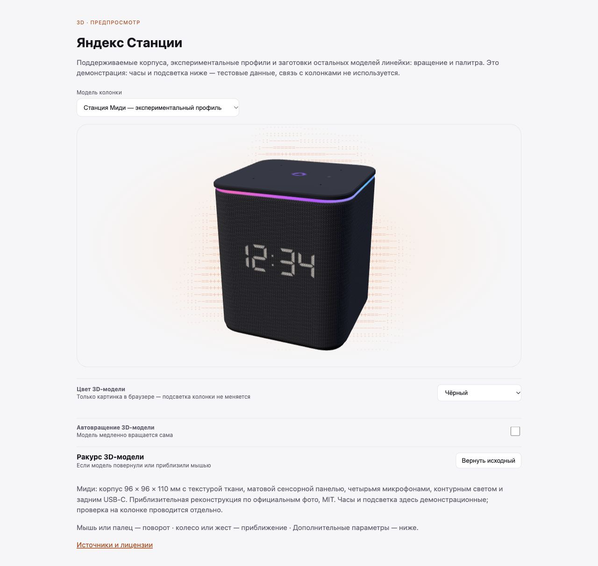

# Станция Миди: cucumber, factory-9

Связано с [issue #7](https://github.com/dimap/yapanel-web/issues/7).
База: YAPanel 0.2.2 (`bd32f0a`). Результаты получены 29–31 октября 2026
на одной Миди с root, ядром 5.4.180/aarch64 и прошивкой
`0.9.1.3.2572674166.20240919.factory-9`.

## Изменения

- Отдельный профиль `midi`: `cucumber` не получает профиль Лайт 2.
  `station-midi` и `yandexmidi` сохраняют профиль Станции 2 из PR #25.
- Для старого adbd длинные команды передаются через sync во временный скрипт;
  код завершения проверяется, временный файл удаляется. Device ID извлекается
  из строки `Device ID:`, независимо от последующих диагностических сообщений.
- Чтение 24 RGB-зон кольца, 6 RGB-зон логотипа и 45 белых каналов дисплея.
  [Карта дисплея](midi-clock-map.factory-9.json) составлена по наблюдениям владельца.
- Короткие пробы цветов и дисплея с сохранением brightness/trigger, возвратом
  состояния и независимой проверкой. Неподтверждённый откат блокирует новые пробы.
- Обычные кнопки кольца/логотипа и краткий вывод текста, даты, температуры
  открываются только после приёмки выбранного устройства и его прошивки.
  Частные результаты приёмки хранятся в каталоге данных и в PR не входят.
- Отдельная приблизительная 3D-модель 96 × 96 × 110 мм: лёгкие материалы,
  живые данные принятой карты, общий интерфейс modelShow/modelRing/modelColor.
  [Источники и лицензия](../../static/models/SOURCES.md).
- Общий адаптер громкости для Миди и Мини 2: Glagol либо полная карта конкретной
  прошивки. При отсутствии обоих источников процент неизвестен; шкала Лайт 2
  не подставляется. Для Mini 2 reset RGB восстанавливает brightness и trigger;
  без снимка ничего не меняет.
- Статус загрузочного хука проверяется чтением. Для Миди и Мини 2 новые файлы
  зависимых функций не создаются без обнаруженного загрузочного пути;
  ручная установка хука из 0.2.2 с подтверждением владельца сохранена. Будильник требует
  реальную карту ALSA и не получает LED-команды чужой модели.
- Новый runtime включён в Docker, Windows ZIP, updater и CI.

## Проверено на устройстве

| Функция | Наблюдение и предел проверки |
|---|---|
| Статус, консоль, логи | Root/модель/прошивка прочитаны из панели; доступны температура, метрики и списки файлов/логов |
| Громкость | Владелец подтвердил 0→5→10% в панели и 10→0→10% голосом; итог Glagol 0.1 и ALSA 26/26 прочитан независимо. Промежуточные уровни — наблюдение владельца |
| «Сказать на колонке» | Одна фраза произнесена правильно на 10%; задержка и повторные запросы не измерены |
| Плеер | Запуск, пауза, продолжение, следующий трек и перемотка подтверждены владельцем и Glagol; исходный трек возвращён на паузу. Точный возврат позиции и отдельный stop не проверены |
| RGB | R/G/B/жёлтый приняты для кольца и логотипа: 8/8, уровень 8/255. Обычная последовательность красный→выкл.→зелёный→возврат принята отдельно для обоих компонентов |
| Дисплей | Сопоставлены 45/45 каналов. Цифры 0–9 на каждой позиции, двоеточие, градус и яркость 20→60→100% приняты; 45 белых каналов/триггеров восстановлены, 90 RGB не изменились |
| Краткий показ | Текст `09:45°`, дата `30.10` и температура процессора `42°`: показ 8 с на 20% и возврат часов приняты |
| Короткий таймер | Владелец подтвердил 00:08→00:00 и возврат часов 31 октября. Длительность проверки — 10 с, без звука; длительный режим этим не проверен |
| Файлы | Upload/read/rename/download/delete временного UTF-8-файла; SHA-256 скачанного файла совпал, тестовые пути удалены |

## Оставшиеся проверки

Постоянные часы, длительный таймер, закрепление надписи, анимации, Bluetooth,
восстановление после обрыва, перезагрузка/автозапуск, будильники/сценарии,
замена звуков, ассистент, YAM/YAM 2 и блокировка аналитики не приняты полностью.
Глобальные `clock/light/logo/boot` остаются выключенными; принятые короткие
операции имеют отдельные проверки на сервере. Полная поддержка не заявляется.
При другой прошивке аппаратную приёмку нужно повторить.

## Проверка на другой Миди

1. Запустить `python3 server.py --model midi --device <adb-target>`.
2. Проверить профиль, плату и прошивку. Сбор только для чтения:
   `python3 tools/midi_readonly.py --help`.
3. В «Обзоре» владелец запускает короткие пробы и отмечает видимый результат.
   До завершения возврата следующая проба не запускается.
4. Сопоставить каналы дисплея, затем проверить цифры, двоеточие, градус и яркость.
   Частный отчёт привязан к выбранному ADB-устройству и прошивке.

На проверенной factory-9 вызов rootkeeper отсутствует, корень только для чтения.
Автозапуск и перезагрузка не проверялись. Исправления init.d из 0.2.2 не считаются
подтверждёнными для этой Миди без отдельного испытания.

## Галерея

Снимки используют демонстрационные данные, без подключения к колонке.
Проверены рендер, палитра, поворот и мобильная ширина 390 px;
ошибок и предупреждений консоли не обнаружено.

[Мобильный вид, 390 px](screenshots/midi-mobile.jpg).
